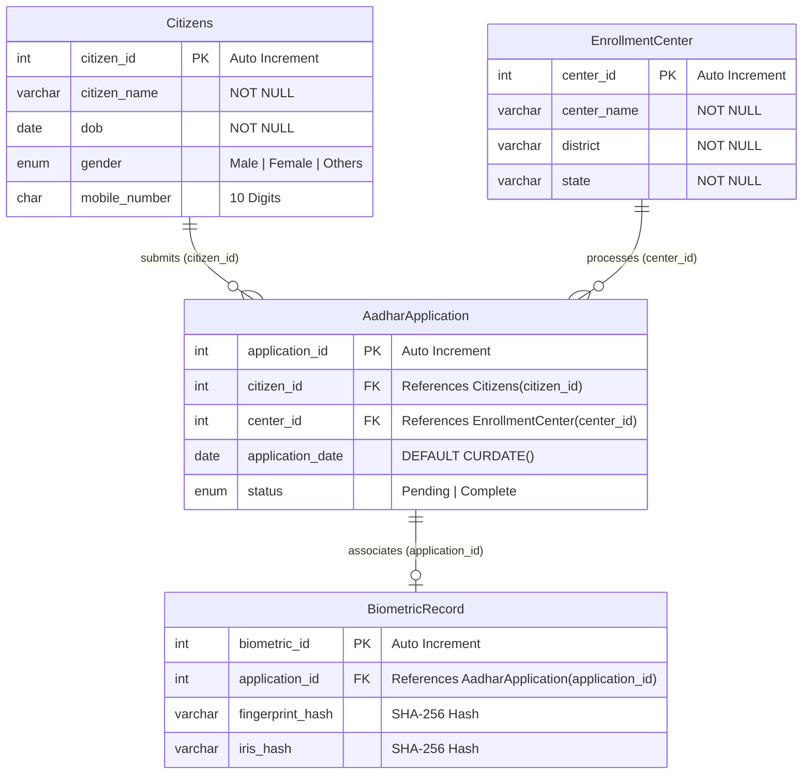

# Aadhaar Enrollment Management System
### Database Management Systems Laboratory (DBMS) — Coursework Project

[](https://aadhar-enrollment-management-system-croton2.vercel.app)
[](https://tidbcloud.com)
[](https://nodejs.org)
[](https://developer.mozilla.org)

> **⚠️ Academic & Educational Disclaimer:**  
> This project is developed strictly for **academic demonstration and laboratory evaluation** in Database Management Systems (DBMS). It is **NOT** affiliated with UIDAI, the Government of India, or any government portal. It does not collect or store actual government Aadhaar numbers, real biometric prints, or sensitive identity information.

---

## 📌 1. Project Overview

The **Aadhaar Enrollment Management System** is a full-stack relational database portal built using **Vanilla JavaScript, Node.js, Express.js, and MySQL (TiDB Cloud)**. It models the core lifecycle of a national identity enrollment management service:

1. **Citizen Demographic Registration** (`Citizens` entity).
2. **Demographic Updation & Corrections** (SQL `UPDATE` transactions modifying registered records).
3. **Certified Enrollment Center Management** (`EnrollmentCenter` entity).
4. **Application Creation with Foreign Key Constraints** (`AadharApplication` linking citizen and center).
5. **Multi-Table Relational Status Tracking** (inspecting enrollment status with visual badges).
6. **Official Aadhaar PVC Identity Proof Card Generation**:
   - High-resolution **.PNG Image Download** via HTML5 Canvas.
   - Standard CR80 wallet-card **Print / Save as PDF** via dedicated `@media print` rules.
7. **Administrative Database Records Management** (SQL `JOIN` queries, real-time search, 1-click demographic editing, status toggles).
8. **Academic Submission & 5-Member Team Spotlight**:
   - Prominently highlighted at the bottom of the Home page and in Section 8.
   - Supports **Faculty Guide / Teacher Name** and **5 Student Team Members with Scholar Numbers**.
   - Interactive in-browser editing modal with instant `localStorage` persistence.

---

## 🌐 Live Production Deployment

- **Live URL:** [https://aadhar-enrollment-management-system-croton2.vercel.app](https://aadhar-enrollment-management-system-croton2.vercel.app)
- **Backend API Base:** `https://aadhar-enrollment-management-system-croton2.vercel.app/api`
- **Database Engine:** TiDB Cloud Serverless MySQL (SSL-encrypted)

---

## 🚀 2. System Modules & Key Features

### 👤 Module 1: Citizen Registration (`TABLE: Citizens`)
- Records citizen identity: Full Name, Date of Birth, Gender, and 10-digit Mobile Number.
- Client-side checks: blocks future dates of birth, enforces 10-digit numeric mobile validation.
- Auto-increments primary key `citizen_id` and provides real-time confirmation.

### ✏️ Module 2: Demographic Details Updation Portal (`SQL UPDATE Citizens`)
- Search and lookup existing registered citizens by ID or dropdown selector.
- Pre-fills current demographic attributes (Full Name, Date of Birth, Gender, Registered Mobile).
- Executes verified transactional `UPDATE Citizens SET citizen_name=?, dob=?, gender=?, mobile_number=? WHERE citizen_id=?`.
- Preserves referential integrity across linked `AadharApplication` tuples.
- One-click trigger **"🪪 View Updated ID Card"** to instantly render the corrected identity proof card.

### 🏛️ Module 3: Enrollment Center Management (`TABLE: EnrollmentCenter`)
- Registers authorized enrollment centers by Center Name, District, and State.
- Auto-generates `center_id` for relational allocation.
- Supports administrative updating of center location details via `PUT /api/centers/:id`.

### 📝 Module 4: New Enrollment Application (`TABLE: AadharApplication`)
- Dynamically loads registered citizens and certified centers from the MySQL database into dropdowns.
- Links `citizen_id` (FK) and `center_id` (FK) into an application record.
- Automatically assigns `application_date = CURDATE()` and default status `Pending`.

### 🔍 Module 5: Application Status Tracking
- Queries the relational database by Application ID.
- Displays applicant demographics, assigned center, district/state, and application date.
- Dynamic color-coded status badges:
  - 🟧 **Pending** (Under demographic & biometric verification)
  - 🟩 **Complete** (Approved & verified in database)
- Includes quick-action **"🪪 View & Download Identity Card"** linking directly to the card generator.

### 🪪 Module 6: Aadhaar Identity Proof Card Generator (Download & Print)
- Generates a verified PVC-format identity proof card based on database records:
  - Ashoka Chakra emblem motif and bilingual header (*भारत सरकार | Government of India*).
  - Photo frame with "Secure Smart Chip" badge and "✓ Verified" green seal.
  - Digitally signed scalable QR code matrix pattern.
  - Citizen details: Full Name, DOB, Gender, Masked Mobile (+91 XXXXXX1234), Center Name.
  - Formatted 12-digit Aadhaar number (`XXXX XXXX XXXX`) derived deterministically from Citizen ID.
- **Download Card (.PNG Image)**:
  - Renders a crisp 1000×630px high-resolution PNG on an off-screen HTML5 Canvas.
  - Automatically triggers clean file download: `Aadhaar_Card_<Citizen_Name>.png`.
- **Print / Save as PDF**:
  - Uses `@media print` calibrated precisely for standard wallet cardstock (CR80: 85.6mm × 53.98mm).
  - Automatically suppresses navigation, headers, forms, and buttons during printing.

### 📊 Module 7: Admin Database Records Viewer
- Tabbed administrative interface with live counts for **Applications**, **Citizens**, and **Enrollment Centers**.
- Real-time client-side search filtering across all table columns.
- Performs multi-table SQL `JOIN` queries across `AadharApplication`, `Citizens`, and `EnrollmentCenter`.
- Admin action to toggle status (`Mark Complete` / `Mark Pending`) with instant database update.
- Quick **"✏️ Edit"** button to jump directly into the Demographic Updation portal for that citizen.
- Quick **"🪪 ID Card"** button on each citizen row to view and download their identity card.

### 🎓 Module 8: Highlighted Academic Submission & 5-Member Team Spotlight
- **Prominently Featured at the Bottom of Home Page & Section 8**:
  - Highlighted top banner with gold badge: `🎓 OFFICIAL ACADEMIC PROJECT EVALUATION`.
  - **Faculty Guide Spotlight**: Highlighted card with 👨‍🏫 icon, Faculty Guide Name, Department, and Evaluator status.
  - **Project Team Spotlight**: Full grid supporting **5 Student Team Members**, each with:
    - Member avatar badge (`S1`, `S2`, `S3`, `S4`, `S5`).
    - Student Full Name.
    - Official scholar number badge (`Scholar No: 2211XXXXX`).
- **In-Browser Edit Modal**:
  - Click **"✎ Edit Faculty & Team (5 Members)"** to update guide name, department, and all 5 team members directly in the browser.
  - Saves instantly to browser `localStorage` and synchronizes across the header, home spotlight, about section, and footer.

---

## 🗄️ 3. Relational Database Schema

The relational database is structured in Third Normal Form (3NF) to ensure referential integrity, eliminate data redundancy, and maintain ACID compliance.



### Table Specifications

| Table | Primary Key | Foreign Keys | Key Attributes |
| :--- | :--- | :--- | :--- |
| `Citizens` | `citizen_id` | *None* | `citizen_name`, `dob`, `gender`, `mobile_number` |
| `EnrollmentCenter` | `center_id` | *None* | `center_name`, `district`, `state` |
| `AadharApplication` | `application_id` | `citizen_id` → `Citizens`<br>`center_id` → `EnrollmentCenter` | `application_date`, `status` |
| `BiometricRecord` | `biometric_id` | `application_id` → `AadharApplication` | `fingerprint_hash`, `iris_hash` |

---

## 🛠️ 4. Technology Stack

| Layer | Technologies Used | Description |
| :--- | :--- | :--- |
| **Frontend** | HTML5, CSS3, Vanilla JS (ES6+) | Semantic layout, government portal aesthetics (Navy `#0f2e5a`, subtle Saffron/Green tricolor touches), no heavyweight framework dependencies. |
| **Card Rendering** | HTML5 Canvas API + `@media print` | Direct client-side PNG image rendering and CR80-sized PDF print stylesheets. |
| **Backend** | Node.js, Express.js 5 | RESTful API routes supporting dual prefix routes (`/api/<route>` and `/<route>`), parameterized SQL queries, CORS. |
| **Database** | MySQL 8.0 / TiDB Cloud | Relational database engine with foreign key constraints, auto SSL connection handling. |
| **Deployment** | Vercel Serverless Functions | Continuous deployment from GitHub with serverless rewrite routing. |

---

## 📂 5. Project Directory Structure

```
Aadhar_Enrollment_Management_System/
│
├── frontend/
│   ├── index.html          # Application markup, forms, cards, and modal dialog
│   ├── style.css           # Institutional portal styling, card layout & print rules
│   └── script.js           # REST API client, DOM routing, card generator & credits manager
│
├── backend/
│   ├── server.js           # Express REST API endpoints & business logic
│   ├── db.js               # MySQL / TiDB database connection pool with auto SSL
│   ├── package.json        # Dependencies (express, mysql2, cors, dotenv)
│   ├── package-lock.json
│   └── .env.example        # Environment variable template
│
├── api/
│   └── index.js            # Vercel serverless function entrypoint (bridges backend/server.js)
│
├── database/
│   ├── database.sql        # Table definitions, sample data, and schema script
│   └── schema.sql          # Standardized database schema script
│
├── vercel.json             # Vercel serverless build and rewrite routing configuration
├── .gitignore              # Ignores node_modules, .env, and local log files
└── README.md               # Comprehensive project documentation
```

---

## 📡 6. REST API Reference

Base URL (Local): `http://localhost:3000/api`  
Base URL (Production): `https://aadhar-enrollment-management-system-croton2.vercel.app/api`

| Method | Endpoint | Description | Request Body |
| :--- | :--- | :--- | :--- |
| `GET` | `/health` | Server & connectivity check | *None* |
| `GET` | `/db-status` | Live database connectivity & table verification | *None* |
| `POST` | `/citizens` | Register a new citizen | `{ citizen_name, dob, gender, mobile_number }` |
| `GET` | `/citizens` | Fetch list of all citizens | *None* |
| `GET` | `/citizens/:id` | Fetch specific citizen by ID | *None* |
| `PUT` | `/citizens/:id` | Update citizen demographic details (SQL `UPDATE`) | `{ citizen_name, dob, gender, mobile_number }` |
| `POST` | `/centers` | Register a new enrollment center | `{ center_name, district, state }` |
| `GET` | `/centers` | Fetch list of all enrollment centers | *None* |
| `GET` | `/centers/:id` | Fetch specific center by ID | *None* |
| `PUT` | `/centers/:id` | Update enrollment center details (SQL `UPDATE`) | `{ center_name, district, state }` |
| `POST` | `/applications` | Create a new Aadhaar application | `{ citizen_id, center_id }` |
| `GET` | `/applications` | Fetch all applications (SQL `JOIN`) | *None* |
| `GET` | `/applications/:id` | Fetch application details (SQL `JOIN`) | *None* |
| `PUT` | `/applications/:id/status` | Update status (`Pending` / `Complete`) | `{ status: "Complete" }` |

---

## ⚙️ 7. Installation & Local Setup

### Prerequisites
1. **Node.js** (v18.x or v20.x+) installed.
2. **MySQL Server** (v8.0+) or a cloud MySQL database (e.g. TiDB Cloud).

### Step 1: Clone the Repository
```bash
git clone https://github.com/Shubh-938croton/Aadhar_Enrollment_Management_System.git
cd Aadhar_Enrollment_Management_System
```

### Step 2: Set Up the Database
Open MySQL Command Line or MySQL Workbench:
```sql
SOURCE database/database.sql;
```
*(This creates the `Aadhar` database, tables, foreign keys, and seed records).*

### Step 3: Configure Environment Variables
Inside `backend/.env` (create from `backend/.env.example`):
```env
DB_HOST=localhost
DB_PORT=3306
DB_USER=root
DB_PASSWORD=your_mysql_password
DB_NAME=Aadhar
PORT=3000
```
> **Note for TiDB Cloud:** Set `DB_HOST=gateway01...prod.aws.tidbcloud.com`, `DB_PORT=4000`, and your cloud database credentials. SSL `{ rejectUnauthorized: false }` is automatically enabled.

### Step 4: Install Dependencies & Run
```bash
cd backend
npm install
node server.js
```

### Step 5: Open the Frontend
Open `frontend/index.html` directly in your browser or run a simple local static server:
```bash
npx serve frontend
```

---

## ☁️ 8. Cloud Deployment (Vercel + TiDB Cloud)

1. **Database**: Create a free Serverless cluster on [TiDB Cloud](https://tidbcloud.com) and execute `database/database.sql` in the TiDB SQL Editor.
2. **Backend & Frontend on Vercel**:
   - Push repository to GitHub.
   - Import repository into Vercel.
   - Configure Environment Variables in Vercel Project Settings:
     - `DB_HOST` = `<your-tidb-host>`
     - `DB_PORT` = `4000`
     - `DB_USER` = `<your-tidb-user>`
     - `DB_PASSWORD` = `<your-tidb-password>`
     - `DB_NAME` = `Aadhar`
3. Deploy! Vercel routes `/api/*` to the serverless function `api/index.js` and serves `frontend/` as static assets.

---

## 👥 9. Academic Coursework Submission & Credits

- **Course:** CS304: Database Management Systems Laboratory (DBMS)
- **Guided By / Submitted To:** Prof. Faculty Guide, Department of Computer Science & Engineering
- **Project Team Members (5 Students):**
  1. Student 1 Name (`Scholar No: 2211XXXX1`)
  2. Student 2 Name (`Scholar No: 2211XXXX2`)
  3. Student 3 Name (`Scholar No: 2211XXXX3`)
  4. Student 4 Name (`Scholar No: 2211XXXX4`)
  5. Student 5 Name (`Scholar No: 2211XXXX5`)

*(Team names and scholar numbers can be dynamically updated at any time using the **"✎ Edit Faculty & Team (5 Members)"** button on the website).*

---

## 📄 License
This educational project is distributed under the MIT License for academic and learning purposes.
