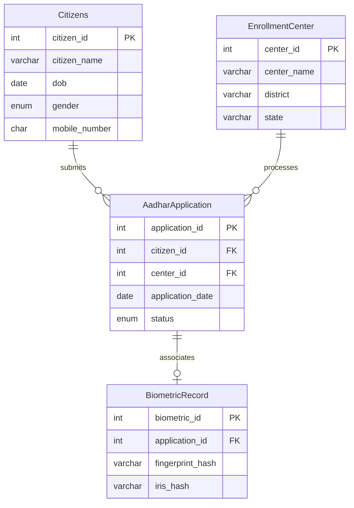

# Aadhaar Enrollment Management System

> **Educational Disclaimer:**  
> This application is an educational demonstration project developed for academic and learning purposes. It is **NOT** an official Aadhaar or UIDAI government website. It does not collect real Aadhaar numbers, actual fingerprints, iris scans, or other sensitive biometric records.

---

## 📌 1. Project Introduction

The **Aadhaar Enrollment Management System** is a full-stack web application designed to demonstrate relational database design, RESTful API architecture, and client-server integration. It models a simplified national enrollment workflow:
- Registering citizens.
- Registering authorized enrollment centers.
- Linking citizens to centers via Aadhaar application requests.
- Tracking application verification status with visual badges.
- Managing and updating application status through an administrative dashboard.

Built using **HTML5, CSS3, Vanilla JavaScript, Node.js, Express.js, and MySQL**.

---

## 🚀 2. Key Features

1. **Citizen Registration**:
   - Collects Citizen Name, Date of Birth, Gender, and 10-digit Mobile Number.
   - Client and server-side validation (checks future DOB, 10-digit numeric mobile, and non-empty inputs).
   - Generates and displays an auto-incremented `citizen_id`.

2. **Enrollment Center Registration**:
   - Records Center Name, District, and State.
   - Generates an auto-incremented `center_id`.

3. **Aadhaar Application Registration**:
   - Dynamically loads existing citizens and enrollment centers from MySQL into dropdowns.
   - Automatically sets application date to current date (`CURDATE()`) and initial status to `Pending`.
   - Demonstrates relational foreign keys (`citizen_id` and `center_id`).

4. **Application Status Tracking**:
   - Search by Application ID.
   - Displays applicant info, center details, date, and visual status badges:
     - 🟧 **Pending** (Orange Badge)
     - 🟩 **Complete** (Green Badge)

5. **Administrative Records Dashboard**:
   - Tabbed views for **Applications**, **Citizens**, and **Enrollment Centers**.
   - Real-time search filters for filtering through records.
   - Instant status toggling (`Mark Complete` / `Mark Pending`) via backend API.

---

## 🛠️ 3. Technologies Used

### Frontend
- **HTML5**: Semantic tags, accessible forms, responsive layout.
- **CSS3**: Custom design with government-service inspired color palette (Navy Blue `#1a237e`, Saffron `#e65100`, Forest Green `#2e7d32`), CSS Grid, and Flexbox.
- **Vanilla JavaScript**: Standard DOM manipulation (`document.getElementById`, `addEventListener`), asynchronous `fetch()` API calls, and in-memory search filtering.

### Backend
- **Node.js**: Asynchronous JavaScript runtime.
- **Express.js**: REST API server and routing framework.
- **mysql2**: Safe MySQL connection driver with parameterized SQL queries.
- **cors**: Cross-Origin Resource Sharing middleware.
- **dotenv**: Secure configuration management for environment variables.

### Database
- **MySQL (v8.0+)**: Relational Database Management System (RDBMS) with foreign keys and cascade rules.

---

## 📂 4. Project Folder Structure

```
Aadhar_Enrollment_Management_System/
│
├── frontend/
│   ├── index.html          # Web application structure & forms
│   ├── style.css           # Styling, themes, responsive layout & badges
│   └── script.js           # Client-side validation, routing & fetch API calls
│
├── backend/
│   ├── server.js           # Express REST API endpoints & business logic
│   ├── db.js               # MySQL database connection using mysql2 & dotenv
│   ├── package.json        # Backend dependencies & npm scripts
│   ├── package-lock.json
│   ├── .env.example        # Environment variable template
│   └── .env                # Local database credentials (ignored in git)
│
├── database/
│   ├── schema.sql          # Standardized SQL schema & relational tables
│   └── database.sql        # Original database creation script
│
├── .gitignore              # Ignores node_modules, .env, and system logs
├── .env.example            # Root environment variable template
└── README.md               # Project documentation & execution guide
```

---

## 🗄️ 5. Database Schema & Explanation

The system uses a relational database named `Aadhar` with four interconnected tables:



### Table Definitions

1. **`Citizens`**:
   - `citizen_id`: INT AUTO_INCREMENT PRIMARY KEY
   - `citizen_name`: VARCHAR(100) NOT NULL
   - `dob`: DATE NOT NULL
   - `gender`: ENUM('Male', 'Female', 'Others') NOT NULL
   - `mobile_number`: CHAR(10) NOT NULL

2. **`EnrollmentCenter`**:
   - `center_id`: INT AUTO_INCREMENT PRIMARY KEY
   - `center_name`: VARCHAR(60) NOT NULL
   - `district`: VARCHAR(60) NOT NULL
   - `state`: VARCHAR(60) NOT NULL

3. **`AadharApplication`**:
   - `application_id`: INT AUTO_INCREMENT PRIMARY KEY
   - `citizen_id`: INT NOT NULL (Foreign Key -> `Citizens.citizen_id`)
   - `center_id`: INT NOT NULL (Foreign Key -> `EnrollmentCenter.center_id`)
   - `application_date`: DATE NOT NULL
   - `status`: ENUM('Complete', 'Pending') NOT NULL

4. **`BiometricRecord`** *(Demonstration Only)*:
   - `biometric_id`: INT AUTO_INCREMENT PRIMARY KEY
   - `application_id`: INT NOT NULL (Foreign Key -> `AadharApplication.application_id`)
   - `fingerprint_hash`: VARCHAR(255)
   - `iris_hash`: VARCHAR(255)

---

## 📡 6. Backend REST API Endpoints

All endpoints use `http://localhost:3000/api` as the base URL.

| Method | Endpoint | Description | Request Body |
| :--- | :--- | :--- | :--- |
| `GET` | `/` | Health check route | None |
| `POST` | `/api/citizens` | Register a new citizen | `{ citizen_name, dob, gender, mobile_number }` |
| `GET` | `/api/citizens` | Fetch all citizens | None |
| `GET` | `/api/citizens/:id` | Fetch citizen by ID | None |
| `POST` | `/api/centers` | Register a new enrollment center | `{ center_name, district, state }` |
| `GET` | `/api/centers` | Fetch all enrollment centers | None |
| `GET` | `/api/centers/:id` | Fetch enrollment center by ID | None |
| `POST` | `/api/applications` | Create a new Aadhaar application | `{ citizen_id, center_id }` |
| `GET` | `/api/applications` | Fetch all applications (SQL JOIN) | None |
| `GET` | `/api/applications/:id`| Fetch application details (SQL JOIN)| None |
| `PUT` | `/api/applications/:id/status`| Update status (Pending / Complete) | `{ status: "Complete" }` |

---

## ⚙️ 7. Installation & Setup Guide

### Prerequisites
1. **Node.js** (v18 or higher) installed on your system.
2. **MySQL Server** (v8.0+) installed and running locally.

### Step 1: Clone or Navigate to the Project
```bash
cd d:\College_DBMS\Aadhar_Enrollment_Management_System
```

### Step 2: Set Up the Database
Open your MySQL terminal or MySQL Workbench and run:
```sql
SOURCE d:/College_DBMS/Aadhar_Enrollment_Management_System/database/schema.sql;
```
*(Or copy and paste the contents of `database/schema.sql` into MySQL Workbench/CLI).*

### Step 3: Configure Environment Variables
Inside `backend/.env` (or copy from `.env.example`):
```env
DB_HOST=localhost
DB_USER=root
DB_PASSWORD=your_mysql_password
DB_NAME=Aadhar
PORT=3000
```
Replace `your_mysql_password` with your actual MySQL root password.

### Step 4: Install Backend Dependencies
```bash
cd backend
npm install
```

---

## 🏃 8. How to Run the Application

### 1. Start the Backend Server
```bash
cd backend
node server.js
```
You should see:
```
✅ MySQL Database connected successfully! (Database: Aadhar)
🚀 Server is running on http://localhost:3000
```

### 2. Launch the Frontend
You can open `frontend/index.html` directly in any web browser:
- Double-click `frontend/index.html`, OR
- Right-click and choose **Open with Live Server** (in VS Code), OR
- Serve with a simple HTTP server:
  ```bash
  npx serve frontend
  ```

---

## 🖼️ 9. Application Sections & Workflow

1. **Home**: High-level overview, server health status dot, and navigation cards.
2. **Citizen Registration**: Enter citizen info; on submit, citizen ID is displayed.
3. **Center Registration**: Enter center name, district, state; on submit, center ID is displayed.
4. **New Application**: Select registered citizen and center; on submit, application ID is returned with `Pending` status.
5. **Track Status**: Enter application ID to view real-time status with green/orange badges.
6. **Admin Records**: Browse records in responsive data tables and toggle status between `Pending` and `Complete`.

---

## 🔮 10. Future Improvements

- Add JWT-based administrative authentication to protect admin views and status-changing operations.
- Integrate document upload simulation (e.g. proof of address/identity placeholders).
- Generate downloadable PDF application acknowledgment slips.
- Add SMS/Email notification simulation upon application completion.
