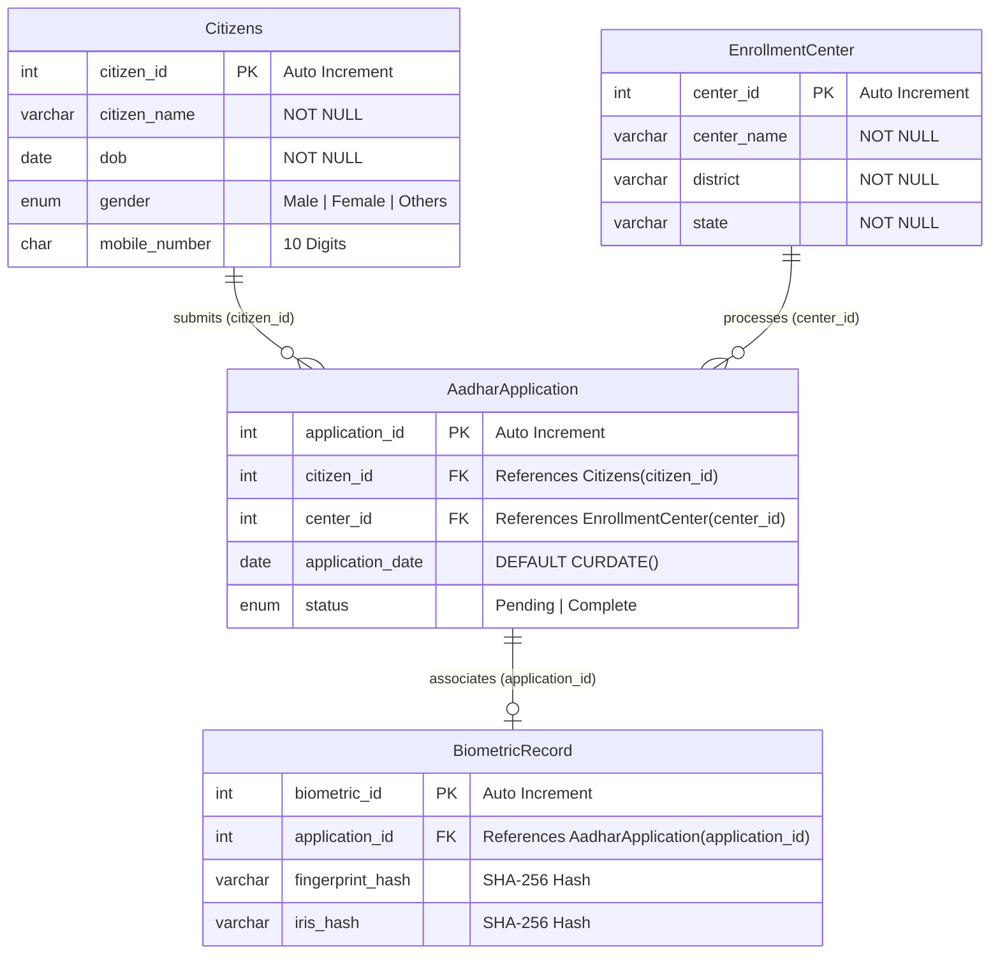

# Aadhaar Enrollment Management System
### Database Management Systems Laboratory (DBMS) — Coursework Project

[](https://aadhar-enrollment-management-system-croton2.vercel.app)
[](https://tidbcloud.com)
[](https://nodejs.org)
[](https://developer.mozilla.org)

> **⚠️ Academic & Educational Disclaimer:**  
> This project is developed strictly for **academic demonstration and laboratory evaluation** in Database Management Systems (DBMS). It is **NOT** affiliated with UIDAI, the Government of India, or any government portal. It does not collect or store actual government Aadhaar numbers, real biometric prints, or sensitive identity information.

---

## 📌 1. Project Overview

The **Aadhaar Enrollment Management System** is a full-stack relational database portal built using **Vanilla JavaScript, Node.js, Express.js, and MySQL (TiDB Cloud)**. It provides a direct, clean, and intuitive **Table Operations Interface** for all core database entities:

1. **`Citizens` Table** — Demographic records (`citizen_id` [PK], `citizen_name`, `dob`, `gender`, `mobile_number`).
2. **`EnrollmentCenter` Table** — Authorized enrollment center locations (`center_id` [PK], `center_name`, `district`, `state`).
3. **`AadharApplication` Table** — Relational tuples linking citizens and centers (`application_id` [PK], `citizen_id` [FK], `center_id` [FK], `application_date`, `status`).
4. **`BiometricRecord` Table** — Security biometric hashes (`biometric_id` [PK], `application_id` [FK], `fingerprint_hash`, `iris_hash`).
5. **In Front of Each Table — Complete CRUD Actions**:
   - 👁️ **Show Data / Refresh**: Displays records currently stored in MySQL with live search filtering.
   - ➕ **Add Data**: Collapsible inline form directly in front of the table to insert new tuples.
   - ✏️ **Update Data**: Universal update modal pre-filled with existing attributes for instant editing (`PUT`).
   - 🗑️ **Remove Data**: Deletes the record with referential integrity & cascading safeguards (`DELETE`).
6. **Academic Submission Details (Highlighted at Bottom of Home Page)**:
   - Dedicated Faculty Guide block (**Teacher Name & Department**).
   - Project Team grid with **5 Student Members and Scholar Numbers**.
   - Interactive in-browser editing modal with instant `localStorage` persistence.
7. **Simple, Clean Minimalist UI**:
   - Strictly black-and-white, clean border layout designed like a classic academic system.

---

## 🌐 Live Production Deployment

- **Live URL:** [https://aadhar-enrollment-management-system-croton2.vercel.app](https://aadhar-enrollment-management-system-croton2.vercel.app)
- **Backend API Base:** `https://aadhar-enrollment-management-system-croton2.vercel.app/api`
- **Database Engine:** TiDB Cloud Serverless MySQL (SSL-encrypted)

---

## 🚀 2. System Modules & Table Operations

### 👥 1. Citizens Table (`Citizens`)
- **Show Data**: Loads all citizens with columns: Citizen ID (PK), Citizen Name, Date of Birth, Gender, Mobile Number.
- **Add Data**: Form directly above the table to insert new citizens with 10-digit mobile and DOB validation.
- **Update Data**: 1-click modal to update Name, DOB, Gender, or Mobile Number (`PUT /api/citizens/:id`).
- **Remove Data**: 1-click removal with cascading cleanup of dependent applications & biometrics (`DELETE /api/citizens/:id`).

### 🏛️ 2. Enrollment Center Table (`EnrollmentCenter`)
- **Show Data**: Displays authorized centers: Center ID (PK), Center Name, District, State.
- **Add Data**: Inline form to register new centers into the relational database.
- **Update Data**: Modal to update Center Name, District, or State (`PUT /api/centers/:id`).
- **Remove Data**: Deletes center and cleans up dependent applications (`DELETE /api/centers/:id`).

### 📝 3. Aadhaar Application Table (`AadharApplication`)
- **Show Data**: Displays relational tuples linking citizens and centers: App ID (PK), Citizen (FK), Center (FK), Application Date, Status.
- **Add Data**: Dropdowns dynamically populated from registered citizens and centers (`POST /api/applications`).
- **Update Data**: Modal to edit citizen assignment, center assignment, or status (`Pending`, `Approved`, `Rejected`).
- **Remove Data**: Removes application and linked biometric hashes (`DELETE /api/applications/:id`).

### 🔐 4. Biometric Record Table (`BiometricRecord`)
- **Show Data**: Displays biometric hashes: Biometric ID (PK), Application ID (FK), Fingerprint Hash, Iris Hash.
- **Add Data**: Form linked to applications with auto-generated SHA-256 cryptographic hashes (`POST /api/biometrics`).
- **Update Data**: Modal to modify biometric hashes (`PUT /api/biometrics/:id`).
- **Remove Data**: Removes biometric record (`DELETE /api/biometrics/:id`).

### 🎓 5. Highlighted Academic Submission Area (Teacher & 5 Students)
- Positioned prominently at the bottom of the page.
- **Faculty Guide**: Teacher Name and Department.
- **Project Team**: 5 Student Members with Scholar Numbers.
- **Edit Modal**: Allows real-time updating and persistence across browser sessions via `localStorage`.
    - Member avatar badge (`S1`, `S2`, `S3`, `S4`, `S5`).
    - Student Full Name.
    - Official scholar number badge (`Scholar No: 2211XXXXX`).
- **In-Browser Edit Modal**:
  - Click **"✎ Edit Faculty & Team (5 Members)"** to update guide name, department, and all 5 team members directly in the browser.
  - Saves instantly to browser `localStorage` and synchronizes across the header, home spotlight, about section, and footer.

---

## 🗄️ 3. Relational Database Schema

The relational database is structured in Third Normal Form (3NF) to ensure referential integrity, eliminate data redundancy, and maintain ACID compliance.



### Table Specifications

| Table | Primary Key | Foreign Keys | Cascade Action | Key Attributes |
| :--- | :--- | :--- | :--- | :--- |
| `Citizens` | `citizen_id` | *None* | *Parent Entity* | `citizen_name`, `dob`, `gender`, `mobile_number` |
| `EnrollmentCenter` | `center_id` | *None* | *Parent Entity* | `center_name`, `district`, `state` |
| `AadharApplication` | `application_id` | `citizen_id` → `Citizens`<br>`center_id` → `EnrollmentCenter` | **`ON DELETE CASCADE`**<br>**`ON UPDATE CASCADE`** | `application_date`, `status` |
| `BiometricRecord` | `biometric_id` | `application_id` → `AadharApplication` | **`ON DELETE CASCADE`**<br>**`ON UPDATE CASCADE`** | `fingerprint_hash`, `iris_hash` |

> [!NOTE]
> **Referential Integrity & Cascading Deletes (`ON DELETE CASCADE`)**:
> - **Citizen Deletion**: Removing a `Citizens` record automatically cascades to delete all linked `AadharApplication` entries and their associated `BiometricRecord` security hashes.
> - **Center Deletion**: Removing an `EnrollmentCenter` automatically cascades to clean up all applications allocated to that center and their corresponding biometrics.
> - **Application Deletion**: Removing an `AadharApplication` automatically purges the associated `BiometricRecord` to guarantee no orphaned rows exist in accordance with 3NF integrity rules.

---

## 🛠️ 4. Technology Stack

| Layer | Technologies Used | Description |
| :--- | :--- | :--- |
| **Frontend** | HTML5, CSS3, Vanilla JS (ES6+) | Semantic layout, government portal aesthetics (Navy `#0f2e5a`, subtle Saffron/Green tricolor touches), no heavyweight framework dependencies. |
| **Card Rendering** | HTML5 Canvas API + `@media print` | Direct client-side PNG image rendering and CR80-sized PDF print stylesheets. |
| **Backend** | Node.js, Express.js 5 | RESTful API routes supporting dual prefix routes (`/api/<route>` and `/<route>`), parameterized SQL queries, CORS. |
| **Database** | MySQL 8.0 / TiDB Cloud | Relational database engine with foreign key constraints, auto SSL connection handling. |
| **Deployment** | Vercel Serverless Functions | Continuous deployment from GitHub with serverless rewrite routing. |

---

## 📂 5. Project Directory Structure

```
Aadhar_Enrollment_Management_System/
│
├── frontend/
│   ├── index.html          # Application markup, forms, cards, and modal dialog
│   ├── style.css           # Institutional portal styling, card layout & print rules
│   └── script.js           # REST API client, DOM routing, card generator & credits manager
│
├── backend/
│   ├── server.js           # Express REST API endpoints & business logic
│   ├── db.js               # MySQL / TiDB database connection pool with auto SSL
│   ├── package.json        # Dependencies (express, mysql2, cors, dotenv)
│   ├── package-lock.json
│   └── .env.example        # Environment variable template
│
├── api/
│   └── index.js            # Vercel serverless function entrypoint (bridges backend/server.js)
│
├── database/
│   ├── database.sql        # Table definitions, sample data, and schema script
│   └── schema.sql          # Standardized database schema script
│
├── vercel.json             # Vercel serverless build and rewrite routing configuration
├── .gitignore              # Ignores node_modules, .env, and local log files
└── README.md               # Comprehensive project documentation
```

---

## 📡 6. REST API Reference

Base URL (Local): `http://localhost:3000/api`  
Base URL (Production): `https://aadhar-enrollment-management-system-croton2.vercel.app/api`

| Method | Endpoint | Description | Request Body |
| :--- | :--- | :--- | :--- |
| `GET` | `/health` | Server & connectivity check | *None* |
| `GET` | `/db-status` | Live database connectivity & table verification | *None* |
| `POST` | `/citizens` | Register a new citizen | `{ citizen_name, dob, gender, mobile_number }` |
| `GET` | `/citizens` | Fetch list of all citizens | *None* |
| `GET` | `/citizens/:id` | Fetch specific citizen by ID | *None* |
| `PUT` | `/citizens/:id` | Update citizen demographic details (SQL `UPDATE`) | `{ citizen_name, dob, gender, mobile_number }` |
| `POST` | `/centers` | Register a new enrollment center | `{ center_name, district, state }` |
| `GET` | `/centers` | Fetch list of all enrollment centers | *None* |
| `GET` | `/centers/:id` | Fetch specific center by ID | *None* |
| `PUT` | `/centers/:id` | Update enrollment center details (SQL `UPDATE`) | `{ center_name, district, state }` |
| `POST` | `/applications` | Create a new Aadhaar application | `{ citizen_id, center_id }` |
| `GET` | `/applications` | Fetch all applications (SQL `JOIN`) | *None* |
| `GET` | `/applications/:id` | Fetch application details (SQL `JOIN`) | *None* |
| `PUT` | `/applications/:id/status` | Update status (`Pending` / `Complete`) | `{ status: "Complete" }` |

---

## ⚙️ 7. Installation & Local Setup

### Prerequisites
1. **Node.js** (v18.x or v20.x+) installed.
2. **MySQL Server** (v8.0+) or a cloud MySQL database (e.g. TiDB Cloud).

### Step 1: Clone the Repository
```bash
git clone https://github.com/Shubh-938croton/Aadhar_Enrollment_Management_System.git
cd Aadhar_Enrollment_Management_System
```

### Step 2: Set Up the Database
Open MySQL Command Line or MySQL Workbench:
```sql
SOURCE database/database.sql;
```
*(This creates the `Aadhar` database, tables, foreign keys, and seed records).*

### Step 3: Configure Environment Variables
Inside `backend/.env` (create from `backend/.env.example`):
```env
DB_HOST=localhost
DB_PORT=3306
DB_USER=root
DB_PASSWORD=your_mysql_password
DB_NAME=Aadhar
PORT=3000
```
> **Note for TiDB Cloud:** Set `DB_HOST=gateway01...prod.aws.tidbcloud.com`, `DB_PORT=4000`, and your cloud database credentials. SSL `{ rejectUnauthorized: false }` is automatically enabled.

### Step 4: Install Dependencies & Run
```bash
cd backend
npm install
node server.js
```

### Step 5: Open the Frontend
Open `frontend/index.html` directly in your browser or run a simple local static server:
```bash
npx serve frontend
```

---

## ☁️ 8. Cloud Deployment (Vercel + TiDB Cloud)

1. **Database**: Create a free Serverless cluster on [TiDB Cloud](https://tidbcloud.com) and execute `database/database.sql` in the TiDB SQL Editor.
2. **Backend & Frontend on Vercel**:
   - Push repository to GitHub.
   - Import repository into Vercel.
   - Configure Environment Variables in Vercel Project Settings:
     - `DB_HOST` = `<your-tidb-host>`
     - `DB_PORT` = `4000`
     - `DB_USER` = `<your-tidb-user>`
     - `DB_PASSWORD` = `<your-tidb-password>`
     - `DB_NAME` = `Aadhar`
3. Deploy! Vercel routes `/api/*` to the serverless function `api/index.js` and serves `frontend/` as static assets.

---

## 👥 9. Academic Coursework Submission & Credits

- **Course:** CS304: Database Management Systems Laboratory (DBMS)
- **Guided By / Submitted To:** Prof. Faculty Guide, Department of Computer Science & Engineering
- **Project Team Members (5 Students):**
  1. Student 1 Name (`Scholar No: 2211XXXX1`)
  2. Student 2 Name (`Scholar No: 2211XXXX2`)
  3. Student 3 Name (`Scholar No: 2211XXXX3`)
  4. Student 4 Name (`Scholar No: 2211XXXX4`)
  5. Student 5 Name (`Scholar No: 2211XXXX5`)

*(Team names and scholar numbers can be dynamically updated at any time using the **"✎ Edit Faculty & Team (5 Members)"** button on the website).*

---

## 📄 License
This educational project is distributed under the MIT License for academic and learning purposes.
